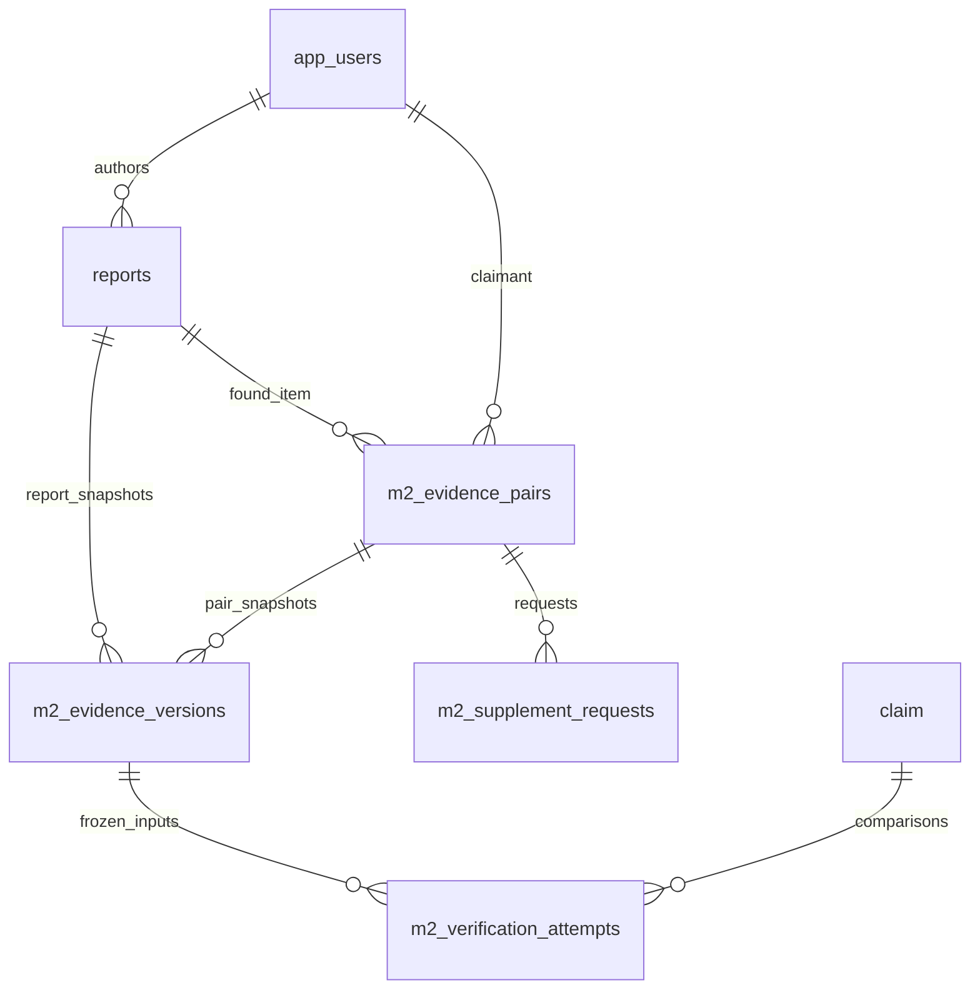

# Member 2 integration: private evidence and DOVE

Work branch: `codex/member2-integration`.
Working folder: `D:\github\Findback-member2-integration`.
Based on the locally saved `main` commit `27fe3d8`; no remote fetch, merge, commit or push was performed.
The original checkout and the three standalone Member 2 prototype folders remain available.

## Run the integrated version

Use this checkout's `backend` and `frontend`, not `member2-backend` or `member2-ui`.
Java 17+ and Node.js are required. The existing team PostgreSQL configuration is in
`backend/src/main/resources/application.properties`; confirm that your local team database is running before starting.
The configuration uses Hibernate schema updates, as the existing team project does. Back up a database containing work before changing its schema.

Open the folder above in VS Code. In a PowerShell terminal:

```powershell
cd D:\github\Findback-member2-integration\backend
.\mvnw.cmd spring-boot:run
```

In a second PowerShell terminal:

```powershell
cd D:\github\Findback-member2-integration\frontend
npm ci
npm run dev
```

Open the localhost address printed by Vite. The normal frontend proxies `/api` to port 8080.
`FINDBACK_API_TARGET` can override the development proxy destination.

Register separate invented claimant and finder accounts. Each creates a report and saves private baseline evidence.
The claimant selects their lost report, finds candidates and submits a claim. Keep the claim number for later retrieval.
Reloading or signing in again preserves server evidence; use **Load my reports** or enter the claim number to reload it.

A team-provisioned `ADMIN` account can select **Staff review**, load a claim, view both histories, request up to two supplements,
record manual comparisons and append staff corrections. Registration always creates ordinary users; there is no public staff-role toggle.
Ask Member 1 for the project's staff-account provisioning process if no staff account exists.

## What changed

- Member 1's `edu.findback.BackendApplication` is the shared entry point and scans Member 3's entities, repositories and services.
- Member 3's allow-all security and fake report/DOVE adapters are restricted to its explicit standalone demo profile. Do not activate that profile in the integrated application.
- Real report ownership and session identity replace demo IDs and `X-User-Id` impersonation.
- CSRF protection is enabled; clients fetch `/api/auth/csrf` before writes. Login rotates the session identifier.
- Report baselines are immutable. Finder and claimant evidence remain separate. Unknown fields are permitted; serial suffixes are normalized and validated on the server.
- A persistent claimant/found-report pair receives an initial snapshot of the lost baseline when its first claim is created. Recreating a report or claim reuses that pair and its evidence/counter.
- One initial claimant submission plus two staff-requested supplements; repeated requests with the same UUID and same content do not consume another attempt. Changed content with a used UUID is rejected.
- Found-report row locks serialize pair changes, including first creation. Evidence, counters and comparison history commit in the same transaction.
- Finder/staff corrections append versions without consuming claimant attempts. Staff corrections and review notes are visible only to reviewers, since they may contain information learned from the opposing side.
- Only the serial suffix is compared automatically. Narrative marks/accessories start as Unknown. Staff record outcomes, reasons and clue-group names; repeated group names count once.
- Strength is Weak for 0–1 useful distinct matches, Moderate for 2, Strong for 3, and Review Required for any contradiction. A conflicting serial suffix is critical. No strength label approves a return.
- Manual assessments name the exact displayed evidence versions; stale assessments are rejected. New versions invalidate earlier manual results for the changed snapshot.
- Staff access uses the existing `ADMIN` role and excludes the finder and every claimant for the same found item, including competing/closed claims. This prevents a staff claimant from reading opposing evidence through another claim. The current team schema has no reviewer assignment model; add an assignment check here if the team introduces one.
- Candidate discovery requires an owned lost report with a baseline. Public report/candidate responses contain no private evidence.
- Ordinary claim responses contain only safe IDs/status. Staff-only comparison data is not returned on claimant endpoints.
- Pending evidence or critical conflicts prevent approval. Changes after approval place the case On Hold, release its reservation and call Member 4's revocation interface.
- Per-account evidence request throttling defaults to 60 requests/minute. This throttle is local to one running server; use shared throttling for multiple instances. Persistent pair counters do not reset when the server restarts.

## API contract

All routes below require a session. Writes also require the CSRF token returned by `/api/auth/csrf`.
Evidence is `{serialSuffix, privateMark, accessoryDescription}`; values can be null/unknown.

| Method | Route | Purpose |
|---|---|---|
| POST | `/api/evidence/reports/{reportId}/baseline` | Save the signed-in report author's baseline; body is evidence |
| GET | `/api/evidence/reports/{reportId}` | Author's submitted history; excludes staff-only corrections |
| POST | `/api/evidence/reports/{reportId}/finder-corrections` | Finder append: `{requestId, reason, evidence}` |
| GET | `/api/evidence/claims/{claimId}` | Claimant's own history, neutral status, count and pending request UUID |
| POST | `/api/evidence/claims/{claimId}/supplements` | Claimant append using the pending staff request UUID |
| GET | `/api/evidence/staff/claims/{claimId}` | Authorized reviewer histories and DOVE summaries |
| POST | `/api/evidence/staff/claims/{claimId}/supplement-requests` | Staff request: `{requestId, reason}` |
| POST | `/api/evidence/staff/claims/{claimId}/corrections/{side}` | Staff append; side is CLAIMANT/FINDER; body `{requestId, reason, evidence}` |
| POST | `/api/evidence/staff/claims/{claimId}/assessments` | Version-bound manual outcomes, clue groups, critical flag and reason |

Assessment body: `claimantVersionId`, `finderVersionId`, `serialOutcome`, `markOutcome`, `accessoryOutcome`,
`serialClueGroup`, `markClueGroup`, `accessoryClueGroup`, `criticalConflict`, `reason`.
Outcomes: `MATCH`, `UNKNOWN`, `CONTRADICTION`. A MATCH requires a useful private clue-group name.

Member 3 consumes `ReportLookupPort` and `DoveEvaluationPort` implemented by `EvidenceService`.
The default application no longer uses fixed report 501/602 or a synthetic Strong result.
Its existing claim controller now obtains the actor from the session. The original standalone staff dashboard files remain in source;
the active app is the connected evidence workspace rather than the old dashboard populated with hardcoded cases.

## Database design

New tables use the `m2_` prefix to avoid collision with the standalone prototype database.
All evidence and comparison records are append-only through the application; JPA marks their stored fields non-updatable.
No raw evidence is included in audit calls. SQL bind logging is disabled in the normal configuration.



Relationships in this diagram are logical application relationships. The existing team project uses scalar IDs rather than foreign keys for cross-module records.
`m2_evidence_pairs` has a unique `(claimant_id, found_report_id)` key; `m2_evidence_versions` has unique `(stream_key, version_number)`;
`m2_supplement_requests` has unique `(pair_id, request_key)`. Pair streams and report streams are distinct so a supplement for one candidate does not rewrite another candidate's initial evidence.
Pair rows survive withdrawal, and claim withdrawal now preserves the claim record rather than deleting it.

## Verification

Verified on 21 November 2026: **23 backend tests passed, 0 failures/errors; 1 pre-existing disabled test skipped**.
Frontend build and lint passed. A headless Edge browser check passed registration/login for separate invented finder/claimant accounts,
report creation, baseline saving, candidate discovery, claim submission and session/claim recovery after page reload, with no browser errors.
Desktop (1280px) and mobile (390px) screenshots were inspected. Temporary browser-test servers were stopped after verification.

```powershell
cd D:\github\Findback-member2-integration\backend
.\mvnw.cmd test
cd ..\frontend
npm run build
npm run lint
```

Automated tests cover baseline immutability, identity spoofing, opposing-party access, self-review, CSRF,
safe candidate/claim outputs, 1+2 limits, duplicate retries, cross-item request misuse, claim/report recreation,
validation rollback, distinct clue counting, stale reviews, staff correction visibility, simultaneous retries,
post-approval hold/reservation release, login/logout, per-account throttling and persistence across application restart.
Tests use isolated H2 databases, including a temporary file-backed database for restart testing. They do not modify the team's PostgreSQL data.
Two pre-existing Member 3 tests were corrected to assert the intended HTTP errors instead of accepting null-dependency failures.
The previously disabled standalone Member 3 context test remains disabled; the shared application context is tested.

## Remaining team dependencies and limits

1. Member 4's `OperationsPort` is still a logging mock. Audit persistence, notifications and actual handover-token revocation must be supplied by Member 4 and tested together. A logged revocation is not proof that a real token was invalidated.
2. Use invented evidence. The team's PostgreSQL configuration still needs its deployment storage protection, restricted database accounts, migrations, backup/retention and HTTPS arrangements agreed and tested. This change does not claim encrypted storage or production readiness.
3. Real PostgreSQL concurrency/deployment verification and full Member 3/4 return-flow tests remain team integration checks. H2 passing is not a PostgreSQL certification.
4. This checkout uses the locally saved team code. Compare against newer teammate commits before merging. No remote history or newer uploads were assumed.
5. The existing schema treats every non-party ADMIN as an authorized reviewer. Case-assignment restrictions require a team-provided assignment model if one is intended.

The standalone Member 2 H2 demo database is not migrated automatically. Keep it as historical synthetic data; start integrated reports with real shared report IDs.
